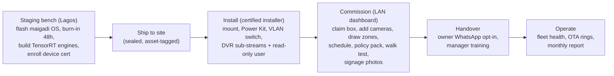
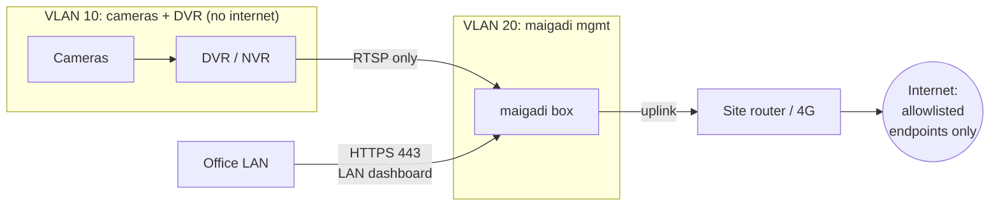

# Hardware and Deployment

Status: draft v0.1 (2026-11-07). VSS capacity numbers come from VSS v3.3.0 benchmarks ([VSS_BASELINE.md §3](VSS_BASELINE.md#3-capacity-numbers-that-drive-our-design-all-1080p-h264-input)). They were measured at **1080p, 30 FPS**. We run **720p at 5–10 FPS**, so our per-box numbers are **ASSUMPTIONS** until the M0 benchmark (BUILD_PLAN T0.3).

## Decision

**v1 ships one hardware SKU:**

- **Tier A:** a Jetson AGX Thor (T5000, 128 GB) industrial box, one per site.
- **Up to 16 cameras.**
- **Hybrid LLM mode** by default.

DGX Spark (Tier B) is the certified alternate from v1.1. Lean Orin (Tier C) is the v2 low-cost SKU. Hub-and-spoke (Tier D) is v2 for chains only. The cloud-VLM variant is rejected.

**Why Thor over Spark for the launch market:**

- **Power.**
  - Thor is 40–130 W configurable, and industrial carriers take wide-range DC input. It can run directly off a 24 V battery with no inverter losses.
  - Spark's GB10 is 140 W TDP behind a 240 W external AC adapter, so it needs an inverter or online UPS.
- **Environment.** Thor modules target industrial and robotics use, and there are fanless and ruggedized carriers. Spark is a desktop. Our sites are hot, dusty (harmattan) and often lack air-conditioning.
- **Proven multi-stream alert verification at the release tag.**
  - At `v3.3.0`, VSS publishes **10-stream** alert verification on AGX Thor (RT-DETR + CR3 Nano BF16: P90 13.9 s; NVFP4: P90 9.7 s).
  - For Spark, the tag shows only single-stream numbers. `develop` later added 14 streams with NVFP4.
- **Same software.** VSS supports both through `HARDWARE_PROFILE` (base and alerts profiles, local RT-VLM, local or remote LLM). Choosing Thor doesn't fork our code.

---

## 1. Tier comparison

| | **A. Thor per site (v1)** | **B. DGX Spark per site** | **C. Lean Orin per site** | **D. Hub-and-spoke hybrid** |
|---|---|---|---|---|
| What runs on site | Everything: CV, VLM, index, agent (LLM in cloud or local) | Same as A | CV + recording + small VLM (Cosmos3 Edge) on events only | CV + recording. VLM at a hub |
| Cameras per site | **16** at 5 FPS (ASSUMPTION; NVIDIA: 4 at 30 FPS 1080p). Sovereign: 10–12 (ASSUMPTION) | ~16 (ASSUMPTION; NVIDIA: 5 at 30 FPS 1080p) | Orin NX 16 GB: 3–4. AGX Orin 64 GB: 6–8 (ASSUMPTION) | 4–8 per site; the hub serves N sites |
| Alert latency (event → verdict) | P90 ≈ 10–14 s at 10 streams (NVIDIA) | P90 ≈ 2.5 s at 1 stream (tag); ≈ 12 s at 14 streams NVFP4 (`develop`) | ASSUMPTION 5–20 s. Not benchmarked by NVIDIA | + WAN transfer 1–5 s + hub queue |
| Alert latency to phone (P90 target) | ≤ 60 s | ≤ 60 s | ≤ 90 s | ≤ 90 s, and only while the WAN is up |
| Q&A depth | Full: events, captions, on-demand VLM | Full | Events + counts. On-demand VLM is weak and slow | Full while the hub is reachable |
| Power draw | Module 40–130 W configurable ([Hackster](https://www.hackster.io/news/nvidia-tells-resellers-to-open-jetson-agx-thor-developer-kit-orders-at-3-499-06e8cbf52441)). VSS sets max-power mode, so plan ~90–130 W (ASSUMPTION) | GB10 140 W TDP, 240 W external PSU ([NVIDIA DGX Spark hardware](https://docs.nvidia.com/dgx/dgx-spark/hardware.html)). Third parties measure ~100–170 W under AI load ([NVIDIA forum](https://forums.developer.nvidia.com/t/dgx-spark-power-clarification/349668)) | Orin NX 16 GB 10–25 W; AGX Orin 64 GB 15–60 W ([CNX 2022](https://www.cnx-software.com/2022/03/22/nvidia-launches-jetson-agx-orin-developer-kit-orin-nx-modules-and-isaac-nova-orin-amr-platform/)) | Site 10–25 W; hub 140–300 W |
| Compute cost per site | Dev kit $3,499 list at launch; resellers $4,599–5,429 in 2026 ([Hackster](https://www.hackster.io/news/nvidia-tells-resellers-to-open-jetson-agx-thor-developer-kit-orders-at-3-499-06e8cbf52441), [Waveshare](https://www.waveshare.com/jetson-agx-thor-developer-kit.htm)). Industrial T5000 box **ASSUMPTION $4.5–6.5k** | $3,999 at launch; Founders Edition **$4,699** after a Feb 2026 increase (secondary source, [layer3labs](https://www.layer3labs.io/guides/dgx-spark-explained); verify) | Orin NX 16 GB module **$999** (1KU), AGX Orin 64 GB module **$2,999**, AGX Orin dev kit **$3,499** after the July 2026 increase ([CNX 2026](https://www.cnx-software.com/2026/07/22/nvidia-increases-the-price-of-jetson-modules-and-devkits-by-up-to-101/)). NX system **ASSUMPTION $1.5–1.8k** | Site ≈ C. Plus hub share |
| VSS support | Base + alerts profiles, local RT-VLM, local or remote LLM. Search needs remote LLM+VLM | Same as A (plus the Spark playbook) | RT-CV + RT-VLM with Cosmos3 Edge only. **Not** on the validated platform list | Hub = A/B/x86 |
| Main failure modes | Unified-memory OOM; thermal throttling; JetPack/VSS version lock; reseller price and supply swings; single box is a SPOF | AC-only PSU (inverter dependency); desktop thermals; single SPOF; consumer support channel | Weak VLM means more false alarms; known OOM with Cosmos3 Edge under concurrency; the RT-CV image needs ~48 GB of disk; unvalidated | WAN outage stops verification; hub SPOF across sites; footage leaves the site (policy change) |
| When to use | **v1 default** | v1.1 alternate; developer workstation | v2 lean SKU (≤ 6 cams, India/SE Asia, fuel stations) | v2, chains with a customer-owned HQ hub only |

**Rejected:** a hybrid that sends frames to a **cloud VLM**. It breaks the core promise ("footage never leaves the site") and the bandwidth model.

**Out of scope for v1:** large sites (32–64 cameras) on x86 with 2× RTX PRO 4500 Blackwell (VSS supports that GPU for the alerts profile with a remote LLM only, and needs 2 GPUs). This is a v2 "Watchman 48" SKU.

## 2. v1 site bill of materials

| Item | Spec | Unit cost (ASSUMPTION) |
|---|---|---|
| maigadi box | Jetson AGX Thor T5000 128 GB, industrial carrier, **wide-range 12–36 V DC input**, 2× Ethernet (≥ 2.5 GbE), **4 TB NVMe** (TLC, ≥ 2,000 TBW), RTC battery, hardware watchdog, 1× GPIO for the enclosure tamper switch | $5,000 landed (incl. duty, VAT, freight) |
| maigadi Power Kit | 24 V 100 Ah LiFePO4 (2.56 kWh), BMS with RS485/USB telemetry, 20 A charger fed from site mains/generator/inverter, DC distribution with fuses, Type 2 surge protector, AVR on the AC input | $700 |
| Managed switch | 8-port, VLAN-capable, fanless (PoE optional) | $150 |
| Enclosure | Lockable, wall-anchored, IP54 with filtered fans, door tamper switch, internal temperature sensor | $150 |
| Backup WAN (optional) | 4G router + data SIM | $80 + data |
| Signage pack | Region-specific, laminated, multilingual | $20 |

**Power Kit runtime** (**ASSUMPTION**, measured in M2):

- Box at ~110 W, switch + router ~20 W, DVR ~40 W: ≈ 170 W. At 90% usable capacity that gives **≈ 13 h**.
- With the DVR on the site's own inverter: **≈ 17 h**.
- The camera power supply stays on the customer's inverter. The survey checks it, and coverage gaps are reported honestly.

## 3. Deployment model

### 3.1 maigadi OS (golden image)

- **Base:** JetPack 7.2 (L4T r39.2) with NVIDIA driver 595.78, the versions VSS requires for AGX Thor.
- **Pins:** Docker Engine `28.x` within VSS's `28.3.3 ≤ v < 29.5.0` window (apt-held); Compose `v2.39.1+`; NVIDIA Container Toolkit `1.17.8+`.
- **Hardening:** see SECURITY_AND_PRIVACY.
  - LUKS full-disk encryption on the data volume.
  - nftables default-deny inbound.
  - SSH disabled (support access is via the tunnel described there).
  - The VSS kernel sysctls are applied.
  - The VSS page-cache cleaner runs as a systemd unit.
  - `nvpmodel -m 0` + `jetson_clocks` run at boot (VSS Thor requirement).
- **Preloaded:**
  - Every container image, pinned by digest.
  - VLM weights (`cosmos3-nano-reasoner:bf16-final`) and RT-DETR models on local disk.
  - The local registry mirror.
- **Runtime rule:** compose runs with `--pull never`. **The box never needs NGC, Hugging Face or the internet to boot or run.** The VSS docs use `--pull always` for development; we must not.

### 3.2 Software layout on the box

- `/opt/maigadi/releases/<version>/` holds the compose files: the VSS v3.3.0 alerts-profile base, plus the maigadi overlay, plus `hw-AGX-THOR` sizing.
- `/opt/maigadi/current` is a symlink to the active release, so rollback means switching the symlink.
- `/data` (LUKS) holds Postgres, VIOS recordings, Elasticsearch, Kafka, model weights, and the outbox.
- **Mode switch** (Hybrid ↔ Sovereign) is a config flag. It changes compose profiles (`llm_local_shared`) and the agent provider, and is applied as a normal release with a health gate.

### 3.3 Network at the site

- The DVR loses internet access by default. Many DVRs run vendor P2P cloud services that ship video off-site. We tell the owner, and disable them with consent.
- The box allows outbound traffic only to: the maigadi regional endpoints (MQTT, LLM gateway, release bucket), NTP, and the 4G router's management.

### 3.4 Installer acceptance checklist (gates commissioning)

1. The survey report passes. Every camera stream is ≥ 720p (or flagged), with a stable bitrate.
2. The box has been on the Power Kit for ≥ 30 minutes, the BMS telemetry is visible, and a pull-the-plug test passes (on-battery event seen; mains restore seen).
3. Every armed zone passes the walk test.
4. Clock drift against NTP is under 2 s.
5. The heartbeat is visible in the fleet console.
6. A test alert reaches the owner's WhatsApp.
7. Signage photos have been uploaded.

## 4. Capacity rules (v1)

- **Hard cap:** 16 cameras per box in Hybrid mode and 12 in Sovereign mode, until M0 proves otherwise.
- **More than 16 cameras:** the customer picks their 16 critical cameras. Multi-box sites are v2.
- **Load shedding order** (also used on battery; see RELIABILITY):
  1. Periodic captions (P3).
  2. Event captions (P2).
  3. CV FPS drops from 5 to 3.
  4. Never alert verification (P0).
- **Storage:** the policy pack sets retention. At 16 cams × 1 Mbps, 7 days uses ≈ 1.2 TB of the 4 TB, which leaves room for 30-day event clips and Elasticsearch/Postgres growth. Disk over 85% triggers ops alerting.
