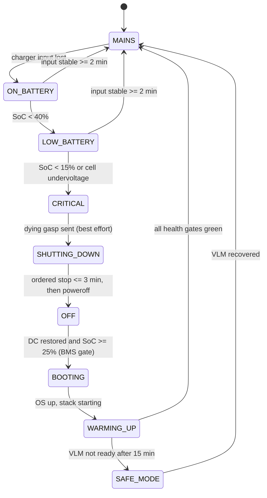
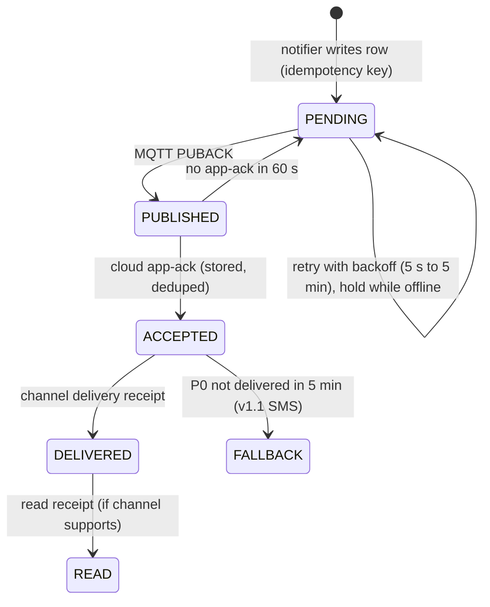

# Reliability: power, connectivity, self-healing, updates, fleet health

Status: draft v0.1 (2026-11-07). Design premise: **power will fail daily and the internet will drop hourly.** If maigadi works there, it works anywhere.

## Decisions at a glance

| # | Decision |
|---|---|
| R1 | **Batteries make the box an online DC UPS.** The Power Kit (charger + LiFePO4) is always in circuit, so generator switch-overs and brownouts never reach the box |
| R2 | **Shutdown is planned, never abrupt.** Load shedding starts on battery. A graceful shutdown starts at 15% state of charge (SoC), and a "dying gasp" message goes to the cloud |
| R3 | **The box boots and runs with zero internet.** All images and weights are local, and `--pull never` |
| R4 | **No alert is ever lost; late alerts are labelled late.** A Postgres outbox with idempotency keys gives at-least-once delivery with dedupe |
| R5 | **Layered watchdogs with a remediation ladder that ends in safe mode** (CV-only alerts), not a boot loop |
| R6 | **Updates are signed, staged, applied in daytime windows, health-gated by a canary clip, and rolled back automatically** |
| R7 | **Silence is a failure.** If a site goes dark during armed hours, the owner is told *why* (power, network or crash) within 30 minutes |

---

## 1. Failure model

Frequencies are **ASSUMPTIONS** for Lagos/Ogun industrial areas, to be measured in pilots.

| Failure | Expected frequency | Detection | Response |
|---|---|---|---|
| Grid outage → generator/inverter switch-over | Daily, several times | BMS: charger input lost | Box stays on battery. Load shedding (§2.2) |
| Prolonged outage (> Power Kit runtime) | Weekly | SoC thresholds | Planned shutdown, dying gasp, auto-restart (§2.3) |
| Brownout / surge on generator start | Daily | AVR / surge protector, BMS voltage | Absorbed by the Power Kit |
| Internet outage (fibre cut, 4G drop, out of data) | Daily, minutes to hours | MQTT disconnect, gateway errors | Store-and-forward. Failover to the 4G backup WAN |
| DVR reboot / channel loss / camera power loss | Weekly | VIOS stream monitor, frame-rate watchdog | Coverage gap recorded. Camera-offline alert if long |
| Service crash / OOM (unified memory) | Monthly | Healthchecks, OOM events | Remediation ladder (§4) |
| Disk filling / NVMe wear | Months | Disk %, SMART | Retention tightening; ops alert |
| Overheating (hot room, blocked fan, dust) | Seasonal | SoC and enclosure temperature | Shed load → throttle → graceful shutdown |
| Bad update | Rare | Health gate, canary | Automatic rollback (§5) |
| Box theft or tampering | Rare | Enclosure tamper switch, sudden heartbeat loss | Alert owner; revoke cert; data protected by LUKS |

## 2. Power

### 2.1 Power state machine (maigadi-node `power` module)

- **Telemetry:** BMS over RS485/Modbus or USB HID, read by maigadi-node every 10 s. Every transition is written to `system_state` (so answers and summaries can say "box was off 01:12–03:40 because of a power outage") and to the heartbeat.
- **Flap protection:** "MAINS" requires input to be stable for 2 minutes, which avoids thrashing during generator starts.

### 2.2 Load shedding (on battery)

| State | Shed | Keep |
|---|---|---|
| ON_BATTERY | Periodic captions (P3); dashboard live tiles | CV on all cameras, alert verification, event captions, Q&A |
| LOW_BATTERY | Event captions (P2); CV FPS 5 → 3; `ask_vlm` limited to 1 per question | CV, alert verification |
| CRITICAL | Everything except a final flush | – |

**ASSUMPTION:** shedding saves 20–35% of box power. Measured in M2 with the `nvpmodel` power modes, if VSS works below max-power mode.

### 2.3 Graceful shutdown and restart

**Shutdown order** (budget ≤ 3 min; the hard cutoff at 10% SoC is the BMS low-voltage disconnect):

1. Stop the rules gate and the visual-memory scheduler (no new work).
2. Let in-flight Alert Bridge verifications finish (≤ 30 s). Flush the notifier to the outbox (Postgres).
3. Publish `up/dying_gasp` (QoS1, best effort): reason, SoC, expected restart condition.
4. Stop RT-CV and Behavior Analytics, then RT-VLM.
5. VIOS stops recordings and finalizes files.
6. Stop Kafka, then Elasticsearch, then run a Postgres `CHECKPOINT` and stop it.
7. `sync`, unmount `/data`, power off.

**Restart:**

- The carrier is set to **auto-power-on when DC is applied** (**ASSUMPTION:** confirm on the chosen industrial carrier).
- The BMS re-enables the box output only at **SoC ≥ 25%** or when mains is present. This prevents boot-shutdown loops on an empty battery.

**Boot sequence** (target: CV alerts live ≤ 5 min after power-on, VLM live ≤ 10 min; **ASSUMPTION**, measured in M0):

1. `maigadi-node` starts first. It reads power state, checks the clock (RTC vs NTP), and checks LUKS unlock, which is automatic via a hardware-sealed key (see SECURITY).
2. Postgres → Kafka → Elasticsearch → VIOS → RT-CV → Behavior Analytics → rules gate → RT-VLM → Alerts MS → maigadi services. Each step is gated on health with a timeout.
3. **Warm-up policy:** until RT-VLM is ready, high-severity armed-zone person events are sent as **"Unverified (system starting)"**. A burglary during a reboot still raises an alert.
4. The box **records the gap** (from shutdown to pipeline live) in `system_state` and `coverage`.

### 2.4 Data durability

- **Postgres:** `fsync=on`, `synchronous_commit=on`, `full_page_writes=on`. Postgres is the source of truth (events, outbox, audit).
- **Kafka** (single node, VSS internal): `log.flush.interval.ms=1000` on alert topics. Losing ≤ 1 s of events on an *abrupt* power loss is accepted, because R1/R2 make abrupt loss rare.
- **Elasticsearch:** treated as rebuildable. A startup job re-seeds alert-type configs from Postgres if the ES config store is missing or corrupt.
- **Filesystem:** ext4 with default journaling and barriers. NVMe drives with **power-loss protection** are preferred (BOM requirement, **ASSUMPTION** on availability at price).
- **Recordings:** a truncated last segment after an abrupt loss is acceptable. VIOS aging handles cleanup.

## 3. Connectivity

### 3.1 Store-and-forward outbox

- **Delivery semantics:** at-least-once from box to cloud. The cloud dedupes on `idempotency_key` (kept 7 days), so delivery to the user is effectively once.
- **Flush order on reconnect:** P0 alerts first (oldest first), then answers, then summaries, then everything else.
- **Staleness rules:**

| Kind | Rule |
|---|---|
| P0 alert | Never dropped. If more than 5 minutes late, the message says: *"Late alert: happened 02:14, delivered 02:41 (site was offline)."* |
| Answer to a question | Delivered if the question is ≤ 2 h old; otherwise *"I was offline when you asked. Please ask again."* |
| Shift summary | Never dropped. Several pending summaries are merged |
| Camera-offline alert | Collapsed into one "camera status" message if the camera has since recovered |

- **Inbound (cloud → box):** questions sit on the cloud until the box acks them.
  - If the box's heartbeat is more than 2 minutes stale, the relay answers immediately with the reason: *"Your Agbara DC box has been offline since 01:12 (power outage, battery ran out). I'll answer when it's back."*
  - The reason comes from the dying gasp or the last heartbeat.

### 3.2 Links and bandwidth

- **WAN:** primary Ethernet uplink plus an optional 4G router as failover. maigadi-node probes the MQTT endpoint every 30 s and prefers the primary link.
- **MQTT:** v5, persistent session, 60 s keep-alive, TLS 1.3, port 8883 with a **WSS/443 fallback** for restrictive networks.
- **Steady-state budget:** ≤ 300 MB per site per month (**ASSUMPTION**; measured in M2).

| Traffic | Estimate |
|---|---|
| Heartbeats | ~3 MB |
| Metrics (5-min, zstd) | ~20 MB |
| LLM traffic (questions + summaries) | ~60 MB |
| Alerts, answers, audit | ~10 MB |
| Logs (WARN+, capped at 5 MB/day) | ≤ 150 MB |
| Clips (on request, ~1–2 MB each) | Metered separately |
| OTA | Metered separately (see §5) |

- **Data-cap guard:** per-site monthly cap from config. At 80% of the cap, metrics drop to hourly and logs to ERROR-only. Alerts are never throttled.

## 4. Watchdogs and self-healing

**Layers:**

| Layer | Mechanism | Detects |
|---|---|---|
| 1 | Hardware watchdog (Tegra WDT) fed by systemd `RuntimeWatchdogSec=30s` | Kernel or OS hang |
| 2 | systemd units for `maigadi-node` and `docker`, with `WatchdogSec` + `Restart=always` | Supervisor or Docker death |
| 3 | Docker healthchecks on **every** container (we add them where VSS lacks them), `restart: unless-stopped` | Service death or hang |
| 4 | **Pipeline liveness** in maigadi-node: per-camera frames processed per minute; Kafka consumer lag; Behavior Analytics output rate; Alert Bridge metrics (`alert_bridge_events_total`, `alert_bridge_e2e_duration_seconds`); RT-VLM health; Postgres write latency; outbox age | "Up but not working" |
| 5 | **Canary self-test**: every 6 h and after every update, a recorded 15 s clip is played through VSS NVStreamer as virtual camera `cam-canary`. Expect: detection → gate → VLM `confirmed` within 60 s. Marked as a test and never delivered | End-to-end alert path |
| 6 | Resource guards: free unified memory < 10% → shed P3/P2; temperature over limit → shed, then planned shutdown; disk > 85% → tighten retention (periodic recording first; event clips on hold are never deleted) | Slow degradation |

**Remediation ladder** (per failing component):

1. Restart the container (up to 3 times in 15 minutes).
2. Restart the dependent group (for example, RT-VLM + Alerts MS).
3. Restart the whole stack.
4. Reboot the box (at most 3 per hour).
5. Enter **SAFE MODE**: CV + rules gate only, alerts sent as unverified, no captions or `ask_vlm`. Raise a P1 ops alert.

Every step is logged to the audit log and visible in the fleet console. Safe mode is a better outcome than a boot loop.

## 5. Remote updates with rollback

### 5.1 Release artifacts

- A **release manifest** (JSON) contains:
  - Version and minimum OS version.
  - Image digests and sizes.
  - Model artifacts with SHA-256 hashes.
  - The compose overlay.
  - DB migrations, written expand/contract so rollback stays possible.
  - Rule-pack and prompt versions.
  - A rollback-compatibility flag.
- **Signing:** the manifest is signed with **cosign** (offline key in an HSM or KMS). The public key is baked into maigadi OS. Key rotation is itself a signed manifest.
- **Two update classes:**

| Class | Contents | Typical size | Delivery |
|---|---|---|---|
| **App** | maigadi services, configs, prompts, rule packs | 100–400 MB | OTA |
| **Heavy** | VSS images (RT-CV alone is ~18 GB compressed), model weights, JetPack | 10–60 GB | Installer USB SSD at quarterly maintenance, or OTA only on unmetered links with customer approval |

### 5.2 Apply flow

1. **Download:** resumable HTTP range requests from the regional bucket or registry. Default cap 2 Mbps, only in the site's data window. Verify the signature and hashes.
2. **Preflight:**
   - Mains power present and SoC > 60%.
   - Disk headroom available.
   - No P0 alert in the last 10 minutes.
   - Local time in the **daytime update window** (default 10:00–15:00; never during armed hours).
3. **Apply:** run expand migrations, switch `/opt/maigadi/current`, then `compose up` (`--pull never`).
4. **Health gate (≤ 15 min):** all healthchecks green, pipeline liveness OK, **canary self-test passes**, and the agent smoke test passes (3 scripted questions answered from fixtures).
5. **Rollback** if any gate fails: switch the symlink back, `compose up` the previous release, report the failure, and pin the site to the previous version.

### 5.3 Rollout rings

| Ring | Scope | Soak |
|---|---|---|
| R0 | 2 lab boxes (staging bench, recorded streams) | 24 h |
| R1 | maigadi-owned and friendly sites | 48 h |
| R2 | 5% of customer sites (≥ 2 sites) | 72 h |
| R3 | 25% | 48 h |
| R4 | 100% | – |

**Auto-halt** if a ring breaches any of:

- Canary pass rate < 99%.
- Alert latency P90 regresses by more than 20%.
- False-alarm rate rises by more than 50%.
- Any crash loop or rollback.

**Prompt and rule-pack changes** follow the same rings and must pass the EVAL_PLAN regression suite first.

### 5.4 OS / JetPack

Rare: at most twice a year. Done in v1 by an installer visit with a reflash and data-volume preservation. Image-based A/B OTA for JetPack on Thor is a v2 goal. **ASSUMPTION:** NVIDIA's Jetson OTA tooling supports Thor/JetPack 7; verify.

## 6. Fleet health monitoring

**Signals per box:** heartbeat (60 s) plus 5-minute metrics:

- Power state, SoC and battery health.
- SoC and enclosure temperature.
- Memory and GPU use.
- Disk % and SMART wear.
- Cameras online.
- Frames processed per camera.
- Kafka lag.
- Verification latency.
- Canary result.
- Outbox depth and age.
- Link type and data used.
- Release version.

**Offline classification** (the cloud runs this when heartbeats stop):

| Last signal | Classification | Owner message (armed hours, after 30 min) |
|---|---|---|
| Dying gasp with reason `low_battery` | Power outage (planned shutdown) | "maigadi at {Site} shut down at 01:12: power outage, battery empty. It will restart when power returns." |
| Last heartbeat showed ON_BATTERY with SoC dropping, then nothing | Probable power loss | Similar, marked "probable" |
| Last heartbeat on MAINS, healthy | Network outage or crash | "maigadi at {Site} lost connection at 01:12. Alerts will be delivered late if anything happens." |
| Enclosure tamper event, then silence | **Possible tampering** | P0 alert immediately |

**SLOs (v1):**

- Canary pass rate ≥ 99% while powered.
- Event → delivery P90 ≤ 60 s while online.
- Heartbeat freshness ≥ 99% while powered and online.
- Zero lost alerts.

**Ops alerting** (to the ops channel and on-call):

- Box offline > 15 minutes.
- 2 consecutive canary failures.
- Safe mode entered.
- Camera offline > 30 minutes in armed hours.
- Disk > 85%.
- Temperature over limit.
- Battery capacity < 70% of nominal.
- Outbox age > 10 minutes while online.
- Device cert expiring in < 14 days.
- Version drift beyond N−1.

**Customer reliability report:** a monthly WhatsApp summary covering box uptime, number and duration of power outages, uptime per camera, and alert statistics. It turns infrastructure pain into visible value.

## 7. Reliability test plan (gates M3)

| Test | Pass criterion |
|---|---|
| 100 random power pulls (mains and battery disconnect) under load | Zero Postgres corruption; zero lost outbox rows; auto-recovery 100% |
| Network flap every 5 min for 24 h; 6 h offline | Zero lost alerts; correct late labels; dedupe holds |
| DVR reboot; unplug a camera; block a lens | Coverage gaps correct; camera alerts within thresholds |
| Kill RT-VLM, Kafka, ES, Postgres (one at a time) | Ladder recovers; safe mode when expected |
| Fill the disk to 95% | Retention tightens; no service crash |
| Clock jump ±1 h; RTC dead at boot | Detected, logged, corrected on NTP; no time-travel events |
| Update with a deliberately broken image | Automatic rollback within 15 min |
| 7-day soak at 16 cameras, 40 °C ambient (heat chamber or hot room) | No thermal shutdown at full load; shedding works |
